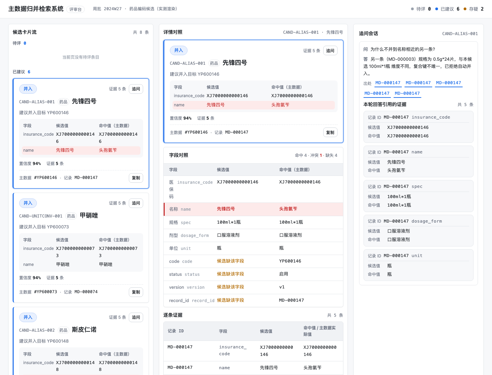
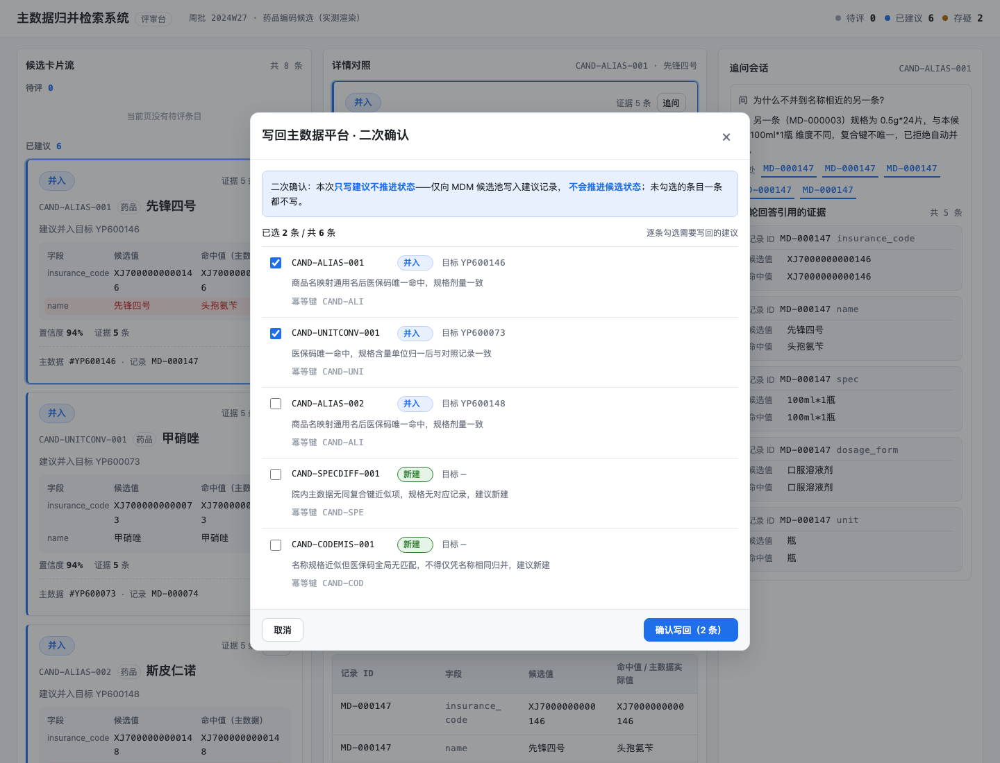
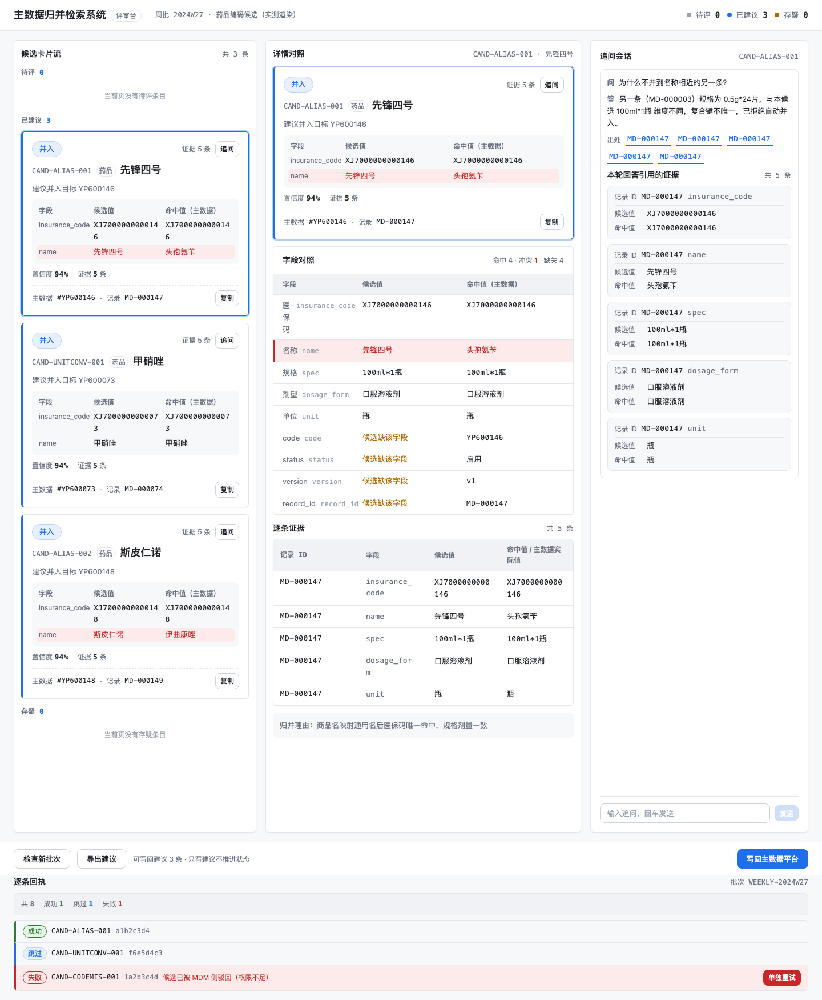
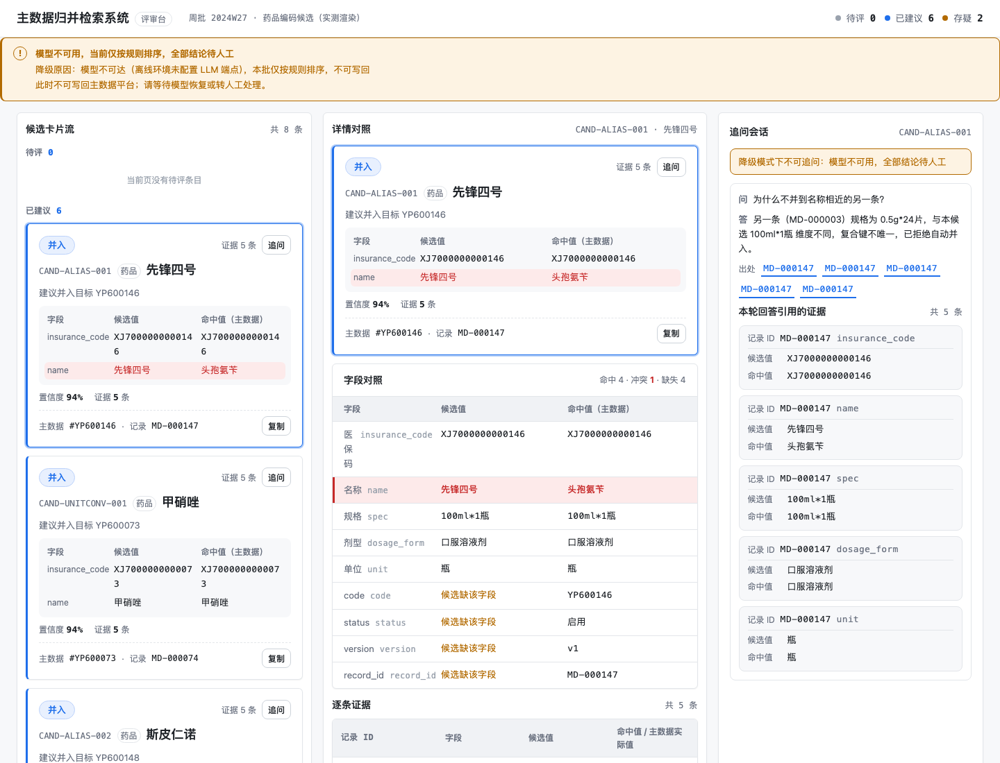

# 主数据归并检索系统

> 信息科数据治理专员把每周一批新增药品 / 收费项目编码候选拖进桌面窗口，系统自动到院内主数据里检索比对，逐条给出「新建 / 并入哪一条 / 存疑」结论与命中字段证据，确认后幂等写回主数据平台候选池。

编码候选入库最费时间的不是「查」，而是「查完记不清为什么并到这一条、漏并了就分叉」。本工具把「合表 → 逐条翻多张导出表 → 记下并入理由 → 手工回填候选池」这四步压成一次批量评审：每条候选给三态结论、给逐字段证据、给可追问的依据，写回前必须逐条确认。

本工具**只写归并建议**。候选的「新建 / 已并入 / 驳回」状态始终由主数据平台侧人工推进。

## 适用场景 / 目标岗位

| 岗位 | 什么时候用 | 得到什么 |
|------|------------|----------|
| 信息科 · 数据治理专员（经办） | 每周一批 200–500 条新增药品 / 收费项目编码候选到达主数据平台待审池 | 每条候选的「新建 / 并入 / 存疑」结论、命中的字段与主数据记录编号、可追问的依据 |
| 数据治理主管（复核） | 专员提交建议后逐批复核 | 带逐字段证据的归并建议单，可按候选、动作、时间筛选并导出 |
| 主数据平台管理员（落库） | 复核通过后把建议落到平台 | 幂等写回的候选池建议记录与逐条回执（成功 / 跳过 / 失败） |
| 信息科 · 运维与排障 | 批处理异常，或需要复盘某一条为什么这么判 | 只读的凭据与端点体检结论、单条归并重放记录、可按候选编号反查的模型调用留痕 |

## 能力要点

- **归属唯一性由规则判定，不靠模型自评**：医保码、规格、剂型、单位归一后构成复合键，复合键不唯一就绝不给「并入」——这正是 Excel 模糊比对最容易出错的地方。
- **多义命中绝不取第一条**：同一复合键命中多条主数据时，列出全部命中记录与冲突字段并转存疑，把判断权交回给人。
- **每条结论都给「凭什么」**：逐字段证据（记录编号、字段名、候选值、命中值）并排可查，不用一句「相似度 0.87」搪塞。
- **就同一条候选追问**：专员问「为什么不并到另一条」时，复用同一份检索快照与已有结论作答，不重新检索、不另起一套说法。
- **关键字段缺失就封顶**：缺规格或缺单位时，置信度被强制截断并强制转存疑，不会因为模型语气笃定就放行。
- **写回前必过逐条确认**：未勾选的建议一条都不写；同一候选同一结论重复提交只记「跳过」，不会产生第二条互相矛盾的建议。
- **失败从不说谎**：主数据平台读失败会显式报「检索失败」，绝不用空结果冒充「院内没有近似项」——那会把一条已有编码误判成新建。

## 快速开始

### 依赖

| 项 | 版本 / 要求 |
|---|---|
| Node.js | ≥ 20（推荐 22 LTS） |
| pnpm | ≥ 9（本项目用 `packageManager` 字段锁定） |
| 操作系统 | Windows 10/11 工位机、macOS 或 Linux 桌面环境 |
| 院内依赖 | 主数据平台接口（读候选 / 读主数据 / 写建议）与一个 OpenAI-compatible 模型端点 |

### 安装

```bash
cd master-data-merge-search
pnpm install
```

### 配置

凭据只从环境变量读取，不写进代码、不写进工作区、不写进审计留痕与导出文件。

```bash
cp .env.example .env      # 按注释填写 MDM_* 与 LLM_* 两组凭据位
```

完整的配置项、默认值与说明见「命令 / API / 配置说明 → 关键配置项」。缺少任一必填位时程序启动即报错并指出缺哪一项。

### 构建与验证

```bash
pnpm install     # 装依赖
pnpm build       # 构建 main / preload / renderer 三段
pnpm test        # 单元与契约测试（不依赖 Electron 运行时）
pnpm dev         # 启动桌面评审台
```

### 主命令速查

```bash
pnpm dev                          # 启动桌面评审台（主入口），托盘常驻不抢屏
pnpm build                        # 构建 main / preload / renderer 三段产物
pnpm preview                      # 预览已构建产物
pnpm test                         # 跑单元与契约测试
pnpm doctor                       # 运维：凭据位与端点连通性体检（只读，加 --json 输出机器可读）
pnpm replay --candidate <id>      # 运维：只读重放单条候选的归并（--write 才写回）
pnpm export --in <建议JSON> --out <路径>  # 运维：导出带证据的归并建议单（JSON / CSV / TXT）
```

> `doctor` / `replay` / `export` 是面向信息科运维的排障通道，不是日常主入口；现场评审请走桌面窗口。

## 命令 / API / 配置说明

### 关键配置项

| 配置项 | 默认值 | 说明 |
|--------|--------|------|
| `MDM_BASE_URL` | 无（必填） | 主数据平台接口根地址 |
| `MDM_API_TOKEN` | 无（必填） | 主数据平台访问令牌，请求头 `Authorization: Bearer <token>` |
| `MDM_TIMEOUT_MS` | `15000` | 主数据平台单次请求超时（毫秒） |
| `MDM_FIELD_MAP` | `./config/mdm-field-map.json` | 院内字段名 → 内部规范字段名 的映射表路径（JSON） |
| `LLM_BASE_URL` | 无（必填） | 模型端点根地址（OpenAI-compatible） |
| `LLM_API_KEY` | 无（必填） | 模型端点访问令牌 |
| `LLM_MODEL` | 无（必填） | 模型名 |
| `LLM_TIMEOUT_MS` | `30000` | 单次模型调用超时（毫秒） |
| `LLM_MAX_RETRIES` | `1` | 网络错误与 5xx 的重试上限；4xx 不重试 |
| `LLM_CONCURRENCY` | `4` | 单批候选的模型并发上限 |

### CLI 子命令 / 接口端点

| 命令或路径 | 用途 | 关键参数 |
|------------|------|----------|
| `pnpm dev` | 启动桌面评审台 | — |
| `pnpm build` | 构建 main / preload / renderer 三段 | — |
| `pnpm test` | 运行单元与契约测试 | — |
| `pnpm doctor` | 凭据位与端点连通性体检（只读，不写数据） | `--json` 输出机器可读结果；`--env-file <路径>` |
| `pnpm replay` | 重放某条候选的完整归并过程 | `--candidate <id>`（必填）；`--write` 才写回；`--json`、`--out` |
| `pnpm export` | 导出归并建议单（同批出 JSON / CSV / TXT 三份） | `--in <建议JSON>`（必填）、`--out <basename>`、`--batch <id>`、`--json` |
| `GET {MDM_BASE_URL}/api/v1/master-data-candidates?status=pending&cursor=` | 读取主数据平台待审候选批次 | `Authorization: Bearer $MDM_API_TOKEN` |
| `GET {MDM_BASE_URL}/api/v1/master-data?domain={domain}&q={q}` | 检索院内已有主数据 | 同上 |
| `POST {MDM_BASE_URL}/api/v1/master-data-candidates/{candidateId}/merge-suggestions` | 写回归并建议记录 | `Authorization`、`Idempotency-Key: sha256(candidate_id｜actionHash)`；body `{action, target_code, rationale, evidence[], confidence}` |
| `POST {LLM_BASE_URL}/v1/chat/completions` | 生成归并结论（OpenAI-compatible） | `Authorization: Bearer $LLM_API_KEY`；`response_format: json_schema`，不支持时降级 `json_object` |

### 错误与降级

| 场景 | 表现 | 处理方式 |
|------|------|----------|
| 主数据平台读失败（超时 / 5xx / 非 200） | 显式报「检索失败」，附端点、状态码与重试次数 | 阻断该条结论产出并转人工；**绝不用空结果冒充「无近似项」** |
| 模型端点不可达或超时 | 结论标记「降级模式」，只给规则排序候选 | 降级结论一律不可写回，界面提示需人工处理 |
| 模型结构化输出校验不通过 | 重试 1 次后仍失败 | 判为模型失败并转人工，不把不合规文本当结论 |
| 候选缺规格或单位 | 置信度被封顶，结论强制「存疑」 | 补齐关键字段后重新评估 |
| 同一复合键命中多条主数据 | 结论「存疑」，列出全部命中记录与冲突字段 | 人工在确认框中指定目标，或先在主数据平台侧消重 |
| 命中记录全部为停用码 | 不产出自动并入目标 | 转「存疑」并说明命中记录均已停用 |
| 候选版本与命中记录版本冲突 | 结论「存疑」并标出版本冲突 | 人工确认后重新评估，不按最新一条硬并 |
| 写回命中幂等键 | 回执「跳过：已存在同哈希建议」 | 不算失败、不重复落库 |
| 写回单条失败 | 该条回执「失败：原因」，其余条目继续写入 | 失败条目可单独重试，不中断同批 |
| 凭据位缺失 | 启动即报错退出并指出缺哪一项 | 按提示补齐环境变量 |

### 对接现有系统

- **只连两处**：主数据平台的三个接口（读候选 / 读主数据 / 写归并建议）+ 一个 OpenAI-compatible 模型端点。不直连 HIS、电子病历或药品采购库。
- **凭据位全部取自环境变量**（见「关键配置项」），请求头 `Authorization: Bearer <token>`；写建议额外带 `Idempotency-Key: sha256(candidate_id｜actionHash)`，与时间戳和重试次数无关。
- **院内字段名各院不一**：用 `MDM_FIELD_MAP` 指向的 JSON 映射表把院内字段名映射到内部规范字段名，不把某一家医院的字段形状硬编进引擎；映射缺字段时显式报错并指出缺哪一项。
- **本机服务不对外**：桌面主进程内起一个只监听 `127.0.0.1` 随机端口的本机服务把引擎暴露给渲染层，院内工位机不需要信息科额外开对外端口。
- **脱敏替身只出现在测试数据层**（`tests/fixtures/`），不是最终对接方式；实连条件是院内部署时提供 `MDM_*` / `LLM_*` 环境变量。

## 典型场景

### 场景 1：数据治理专员每周一批候选入库

专员周一上午收到主数据平台待审池里新到的 236 条药品编码候选，把批次表拖进评审台窗口，系统按批次逐条检索院内主数据并给出三态结论；专员逐条扫卡片，重点看存疑那几条。

```bash
pnpm dev            # 启动评审台；托盘常驻，角标显示待确认条数
pnpm doctor         # 先体检：凭据位是否齐备、三个主数据端点与模型端点是否可达
# 之后在窗口内拖入候选批次表，等待卡片流逐条淡入
```

产出：每条候选一张卡片——三态标签 + 左右并排的字段对照 + 逐字段证据 + 命中的主数据编码与记录编号。

### 场景 2：数据治理主管复核归并建议单

专员对存疑条目逐条追问后勾选确认，建议写回平台候选池；主管在复核环节按批次导出一份带证据的归并建议单，逐条核对「凭什么并到这一条」。

```bash
pnpm export --in outputs/sample-batch/suggestions.json --out outputs/report --batch 2026-W02
# 同批产出 report.json / report.csv / report.txt；复核时按候选编号、动作、时间逐条对照证据
```

产出：一份按批次分组、每条带序号与确认人、回执状态的建议单；含姓名 / 证件号形态的数据在导出前会被拦截。

### 场景 3：信息科运维用体检与重放排障

某天一批候选里 12 条全部判「存疑」，运维先跑体检确认端点与凭据，再对其中一条做重放，看它在检索、闸门、归并三个环节各发生了什么。

```bash
pnpm doctor                                   # 只读体检，不发业务数据、不写任何东西
pnpm replay --candidate CAND-ALIAS-001        # 重放单条：检索 → 闸门 → 归并 → 结论 + 证据 + 调用留痕（只读）
pnpm replay --candidate CAND-ALIAS-001 --write  # 确认需要落库时显式加 --write，仍走确认门与幂等键
```

产出：单条候选的完整结论、证据链与模型调用元数据（模型、提示词哈希、耗时、是否降级）。

## 输出样例
### 归并建议 JSON（脱敏样例）

```json
{
  "candidate_id": "样例候选-001",
  "domain": "drug",
  "action": "merge",
  "target_code": "样例主数据编码-001",
  "confidence": 0.93,
  "rationale": "医保码相同，规格与单位归一后一致，剂型一致",
  "evidence": [
    {
      "record_id": "样例记录-001",
      "field": "insurance_code",
      "candidate_value": "样例医保码-001",
      "matched_value": "样例医保码-001"
    },
    {
      "record_id": "样例记录-001",
      "field": "spec",
      "candidate_value": "0.25g*12片",
      "matched_value": "0.25g×12片"
    }
  ],
  "uncertain_reason": null,
  "missing_fields": [],
  "degraded": false
}
```

`action` 只有三种取值：`create`（新建）、`merge`（并入哪一条）、`uncertain`（存疑）。存疑时 `uncertain_reason` 必填，取值为「多义命中 / 关键字段缺失 / 无近似项 / 版本冲突 / 模型输出不合法 / 检索失败」之一。

### 归并建议单 CSV 片段（脱敏样例）

```csv
时间,candidate_id,action,target_code,置信度,证据条数,确认人,回执状态
2026-01-01 09:30,样例候选-001,merge,样例主数据编码-001,0.93,2,数据治理专员,成功
2026-01-01 09:30,样例候选-002,uncertain,,0.50,3,数据治理专员,失败:候选已被平台侧驳回
```

## 概念 / 实测对照

### 视觉目标

评审台的目标画面见 [`docs/concepts/visual-target-p1.md`](docs/concepts/visual-target-p1.md)（结构化视觉目标卡，本环境不具备图像生成能力，故不伪造概念图）：

| 状态 | 目标画面 |
|---|---|
| 起始态 | 屏幕右下角一个深蓝托盘图标，不弹窗不抢屏；右键三项「打开评审台 / 待确认 N 条 / 检查新批次」；有新批次时图标旁出现数字角标 |
| 首个可用瞬间 | 窗口中央出现候选卡片流：每张卡片顶行左一枚三态标签、右「证据 N 条 · 追问」；中段左右并排两列字段（左＝候选值，右＝命中值）；底行等宽小字「主数据 #<code> · 记录 <record_id>」 |
| 成形态 | 顶栏三枚计数（待评 / 已建议 / 存疑）；左侧候选列表行首三态色条；右侧常驻会话栏显示同一候选的历史问答与出处；右下角「写回主数据平台」点开逐条确认框，确认后逐条显示回执行（成功 / 跳过 / 失败） |

配色以 `#F7F8FA` 底、`#FFFFFF` 面板为主，主色 `#1F6FEB`（并入）、`#2E7D32`（新建）、`#B26A00`（存疑）、`#C62828`（失败）；界面字 `PingFang SC`，编码与幂等键等宽。

### 实测证据

以下均为真实评审台组件（`src/renderer/App.vue` 及全部子组件、`tokens.css`）在 headless Chrome 1440px 视口下的实测渲染，数据由真实基准语料经真实检索、闸门、字段对照与证据链计算得到；不是设计稿、概念图或事后效果图。









> **诚实标注**：上方四张为 `docs/screenshots/` 下的真实实测画面，左侧目标为 `docs/concepts/visual-target-p1.md` 的视觉目标卡。目标描述的是理想布局，实测受真实数据长度与视口约束，两者存在差距，本项目不声称完全一致，也不生成「事后效果图」抹平差距。**数据来源说明**：候选与对照主数据、字段 diff、证据链 `record_id` 全部来自 `tests/fixtures/corpus` 与真实规则函数；因离线环境未配置真实模型端点，唯一命中类结论在引擎里会走确定性降级，故截图 harness 按语料 `source_note` 的人工标注还原三态结论（`source=human`），仅用于渲染真实界面，绝不冒称真实模型推理输出。**桌面外壳真启动**：本机已备齐 Electron 45.2.3 运行时二进制，并有界前台真启动冒烟实测（占位凭据、不连真实端点、退出时整组回收无残留守护进程，完整日志见 round 根 `logs/task49-electron-launch.log`）：主进程打印 `桌面外壳就绪`，本机 h3 服务在回环随机端口监听 7 条白名单路由，托盘构造与角标刷新（待确认 0 条）均执行，退出流程打印 `[local-server] 已停止`，主进程 SIGTERM 未自行退出、由 SIGKILL 整组兜底回收无残留守护进程。故窗口生命周期、托盘常驻与角标计数、本机服务三项由真实 Electron 主进程验证（另见对应单元测试）。**仍未截图项**：采集会话无图形窗口服务，托盘图标的像素画面与 Electron BrowserWindow 内的渲染像素未做截屏；上方四张评测截图仍为 headless Chrome 对真实组件的渲染，不冒称为 Electron 窗口截图，也不为托盘放任何占位图。采集方式见 `scripts/shots/`，可复现命令见「验收与自检」与 `docs/cli.md`。

## 架构与数据流

```
┌────────────────┐  待审候选批次   ┌──────────────────────────────────────────┐
│ 主数据平台     │ ──────────────► │ 桌面评审台（Electron 主进程）            │
│ 待审候选池     │                 │                                          │
└────────────────┘                 │  字段规范化 → 唯一性闸门 → 检索与上下文    │
┌────────────────┐  院内主数据     │  装配 → 归并引擎（ModelGateway · 三态 +   │
│ 主数据平台     │ ──────────────► │  证据链）                                │
│ 主数据全量     │                 │        │                                 │
└────────────────┘                 │        ▼                                 │
                                     │  ┌──────────────┐        ┌─────────────┐  │
                                     │  │ 评审台界面    │◄──────►│ 追问会话     │  │
                                     │  │ 卡片流/证据表 │ 同一快照 │ 同一条候选  │  │
                                     │  └──────┬───────┘        └─────────────┘  │
                                     └─────────┼────────────────────────────────┘
                                               │ 人工逐条勾选确认
                                               ▼
                              ┌────────────────────────────────────────────────┐
                              │ 主数据平台候选池 · 归并建议记录（幂等写回）       │
                              │ POST /api/v1/master-data-candidates/{id}/       │
                              │      merge-suggestions                         │
                              └────────────────────────────────────────────────┘
```

### 关键不变量

- **归属唯一性由规则判定**：复合键（医保码 ∧ 规格 ∧ 剂型 ∧ 单位，归一后）不唯一时一律转存疑，绝不取第一条。
- **未确认不写回**：未在确认框逐条勾选确认的建议，不产生任何一次写回调用。
- **幂等键与时间无关**：`sha256(candidate_id｜actionHash)`；重复提交只记「跳过」，不产生第二条建议。
- **检索失败 ≠ 检索为空**：失败阻断结论并显式报错，不用空结果冒充「无近似项」。
- **审计链只增不改**：撤回 = 追加一条带 `supersedes` 的新建议，历史条目一律保留。
- **只写建议，不推进状态**：候选的「新建 / 已并入 / 驳回」始终由主数据平台侧人工推进。

## 安全与合规边界

- 模型输出只是**建议**，不是结论：置信度低于阈值、证据缺失、多义命中一律转「存疑」，由专员复核。
- **不推进主数据平台侧的候选状态**——本工具只写建议记录，状态流转始终由平台侧人工完成。
- **只落编码与字段值**，不落患者可识别明细；落盘前做姓名 / 证件号形态扫描，命中行拒收且不入库。
- 凭据只从环境变量读取，不写入代码、工作区、调用留痕或导出文件；留痕中密钥只记掩码。
- 审计链只增不改，每条建议都可按候选编号反查到模型调用留痕与提示词哈希，便于复核与迎检。

## 验收与自检

| 验收项 | 命令 | 期望结果 |
|--------|------|----------|
| 工程底座安装 | `pnpm install` | 依赖安装成功，无报错 |
| 三段构建 | `pnpm build` | 产出 main / preload / renderer 三段产物 |
| 测试套件 | `pnpm test` | 全部通过 |
| 类型检查 | `pnpm typecheck` | 无类型错误 |
| 桌面评审台启动 | `pnpm dev` | 打开评审台窗口，托盘常驻不抢屏 |
| 凭据与端点体检 | `pnpm doctor` | 逐项列出缺失凭据位；有必须处理的项时非零退出 |
| 单条归并重放 | `pnpm replay --candidate <id>` | 输出该条的结论、证据链与调用元数据，默认不写回 |
| 归并建议单导出 | `pnpm export --in <建议JSON> --out <basename>` | 同批产出列序固定的 JSON / CSV / TXT 建议单 |
| 基准对拍与放量判定 | `pnpm tsx scripts/compare_benchmark.ts` | 160 条标注；错误归并率 > 0 判不放量；模型路径未实连时标「未验证」，详见 `reports/benchmark/` 与 `docs/examples.md` |
| 真实运行截图 | `ls docs/screenshots/` | ≥ 3 张真实渲染 png，复现命令见 `docs/cli.md` |

## 项目结构

```
master-data-merge-search/
├── package.json                 # 工程元数据与脚本入口（dev/build/test/doctor/replay/export）
├── tsconfig.json                # TypeScript 编译与路径别名配置（strict，无 emit）
├── electron.vite.config.ts      # 三段构建配置：main / preload / renderer
├── vitest.config.ts             # 测试配置：node 环境，单元与契约测试不依赖 Electron
├── .env.example                 # 凭据位模板（MDM_* 与 LLM_*），不含任何真实密钥
├── .gitignore                   # 排除依赖、构建产物、运行时数据与 .env
├── README.md                    # 本文档：产品说明
├── LICENSE                      # MIT 许可证
├── qrcode.jpg                   # 公众号二维码
├── config/
│   └── mdm-field-map.json       # 院内字段名 → 内部规范字段名 映射表
├── docs/                        # 文档分层：概念卡 / 实测截图 / CLI / 样例 / 架构
│   ├── concepts/visual-target-p1.md  # 视觉目标卡（非实测截图）
│   ├── screenshots/             # 真实运行截图（采集任务写入）
│   ├── cli.md                   # 运维 CLI 完整参数参考
│   └── examples.md              # 脱敏输出样例集 · 架构与状态机细节
├── src/
│   ├── main/                    # 主进程：窗口生命周期、托盘角标、本机服务、工作区
│   ├── preload/                 # 白名单 IPC 通道，渲染层不外泄 Node 能力
│   ├── renderer/                # 评审台界面：候选卡片流、证据表、追问栏、确认框
│   │   └── styles/tokens.css    # 设计 token：色板、8px 栅格、字体层级
│   ├── core/
│   │   ├── normalize/           # 字段规范化：编码字符层、全半角、单位、规格、拼音
│   │   ├── binding/             # 唯一性闸门：复合键计算、唯一性判定、多义拒答
│   │   ├── retrieval/           # 对接层与检索：MDM 客户端、字段映射、分桶上下文
│   │   ├── model/               # 模型网关：单一 OpenAI-compatible 通道与调用留痕
│   │   ├── engine/              # 归并引擎：三态结论、证据链、队列、降级、基线
│   │   ├── followup/            # 追问会话：投影、压缩、越界拒绝
│   │   ├── writeback/           # 写回：确认门、幂等键、逐条回执
│   │   └── audit/               # 审计链与隐私闸门：只增不改、姓名证件号扫描
│   ├── cli/                     # 运维通道：doctor / replay / export
│   └── shared/                  # 环境变量配置（无硬编码密钥）
├── scripts/                     # 数据准备与基准对拍脚本
└── tests/
    ├── unit/                    # 单元测试
    ├── contract/                # 契约测试：请求方法·路径·头·body 逐字段比对
    └── fixtures/                # 脱敏测试数据层（替身只出现在这一层）
```

## License

MIT

---

## 关注我们

欢迎扫码关注公众号，获取项目更新与交流加群：

